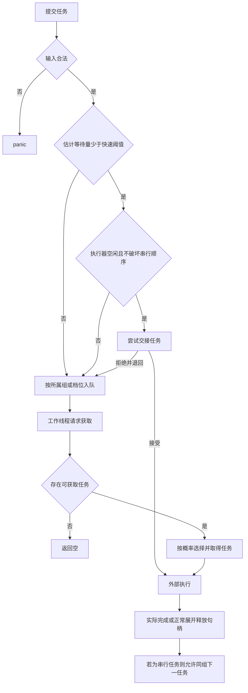

# lock-free-task-pool · 业务流程（L1）

| 操作 | 条件 | 结果/后续状态 |
|---|---|---|
| 提交 | 非法串行组 | panic，不接收任务 |
| 提交 | 估计等待量达到阈值或不能安全快速交接 | 入所属组/档位等待 |
| 快速交接 | 执行器接受 | 任务交执行器，同组保持占用至完成 |
| 快速交接 | 执行器拒绝 | 收回原任务并入队，恢复可继续调度的状态 |
| 获取 | 有可获取任务 | 返回唯一任务句柄；串行组进入占用 |
| 获取 | 无可获取任务 | 返回空，不阻塞 |
| 完成 | 释放句柄 | 串行组解除占用；并发任务不限制同档后续获取 |

## 完备性核对

来源覆盖用户对话、现有方案注释与骨架，未引外部方案。九维：使用者、输入、输出、状态转换、正常路径、异常、并发、生命周期、性能均已核对；未决需求为无。现有位布局与裸指针作为技术素材留至 L7。
