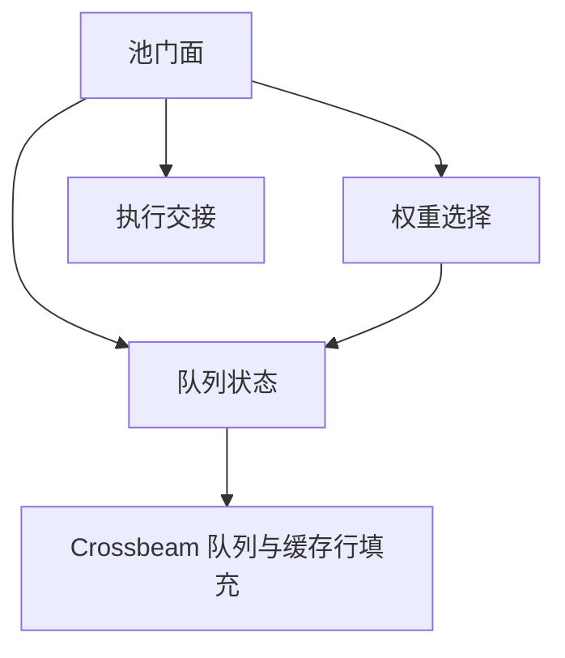

# 模块依赖（L5）

| 调用方 | 依赖方 | 用途 |
|---|---|---|
| 池门面 | 队列状态 | 入队、认领、获取、恢复 |
| 池门面 | 权重选择 | 从可执行候选中选择 |
| 池门面 | 执行交接 | 尝试快速交付，拒绝取回 |
| 权重选择 | 队列状态 | 依赖状态的快照表示约定，仅解释输入；不调用其修改接口 |
| 队列状态 | Crossbeam | 复用现有存储与填充能力 |

本设计不设层级，依赖只允许本表列出的逻辑方向。图为运行时逻辑依赖，无环。执行器方法引用公开句柄类型不构成反向运行时调用。
