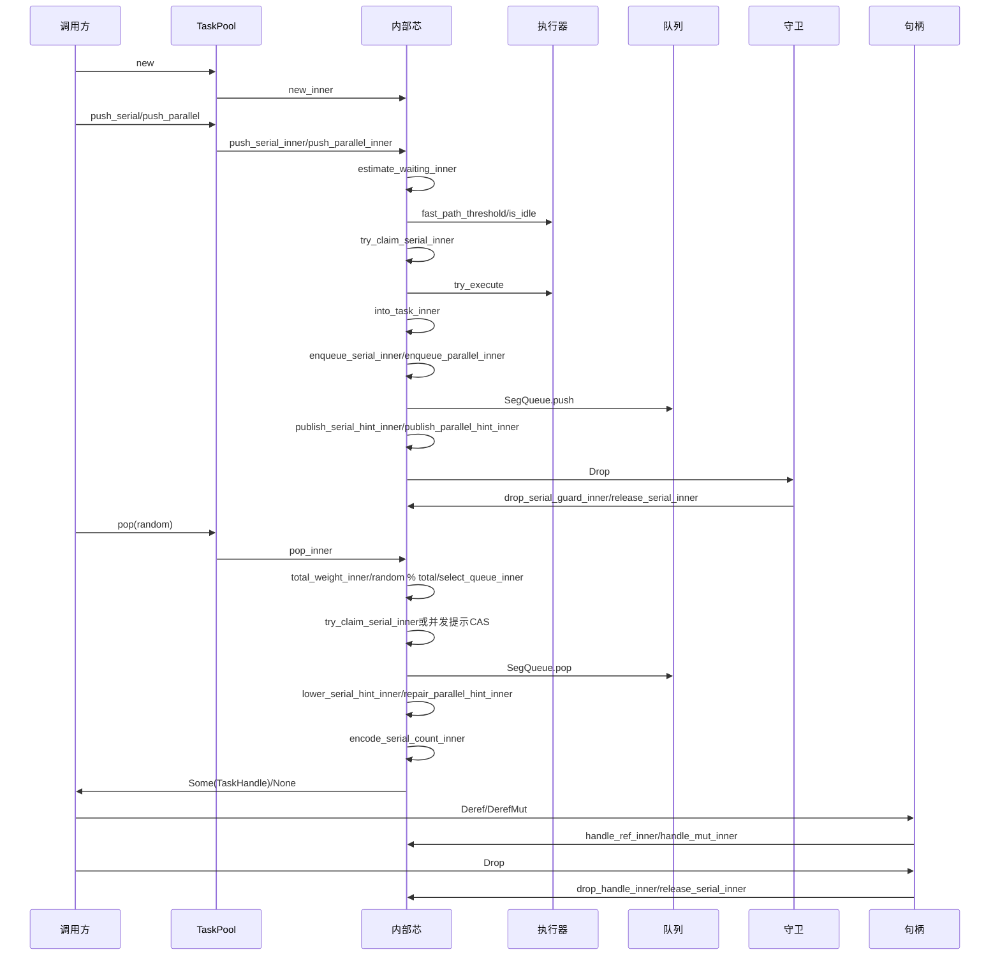

# lock-free-task-pool · 预期调用链（L7 精简档）

## 契约指针

公开声明和失败后状态见[src/lib.rs](../../../src/lib.rs)；内部表示、不变量、恢复循环与所有权伪码见[src/task_pool_inner.rs](../../../src/task_pool_inner.rs)。契约单向指向源码，不在本册复制。前两切片已有实现，公开静态接口及长度采样已更新；第三切片待dev-impl重新审查，第四快速交接仍为TODO。普通测试42通过，3个有界Loom模型通过；旧放行结论不适用于当前修改。

## 调用图

## 调用源表

图中每条消息按顺序与以下每行一一对应；图不表达分支条件，分支由源表列明确。

| 调用方 | 被调方 | 调用节点 | 分支与状态 |
|---|---|---|---|
| 调用方 | TaskPool | new | 创建静态池，复制静态引用共享 |
| TaskPool | 内部芯 | new_inner | Box::leak直接静态池，无内部Arc/TaskPoolInner |
| 调用方 | TaskPool | push_serial/push_parallel | 提交 |
| TaskPool | 内部芯 | push_serial_inner/push_parallel_inner | 公开SerialQueueIndex已校验，内部保留防御检查 |
| 内部芯 | 内部芯 | estimate_waiting_inner | 阈值判断 |
| 内部芯 | 执行器 | fast_path_threshold/is_idle | 少于阈值才查空闲 |
| 内部芯 | 内部芯 | try_claim_serial_inner | 串行快速路径先认领空队列 |
| 内部芯 | 执行器 | try_execute | 接受或拒绝原句柄 |
| 内部芯 | 内部芯 | into_task_inner | 拒绝时建立守卫并拆解任务 |
| 内部芯 | 内部芯 | enqueue_serial_inner/enqueue_parallel_inner | 普通或拒绝回退 |
| 内部芯 | 队列 | SegQueue.push | 发布任务 |
| 内部芯 | 内部芯 | publish_serial_hint_inner/publish_parallel_hint_inner | 任务发布后的提示发布 |
| 内部芯 | 守卫 | Drop | 回退发布完成或预发布展开 |
| 守卫 | 内部芯 | drop_serial_guard_inner/release_serial_inner | 仅清used |
| 调用方 | TaskPool | pop(random) | 不主动等待任务到达，底层可能等待在途写入 |
| TaskPool | 内部芯 | pop_inner | 候选耗尽None |
| 内部芯 | 内部芯 | total_weight_inner/random % total/select_queue_inner | 总权重0返回None，否则random取模；重试复用输入 |
| 内部芯 | 内部芯 | try_claim_serial_inner或并发提示CAS | 竞争重读 |
| 内部芯 | 队列 | SegQueue.pop | 成功取出任务，取空排除；无独立计数 |
| 内部芯 | 内部芯 | lower_serial_hint_inner/repair_parallel_hint_inner | 串行跨档或并发饱和/取空修复 |
| 内部芯 | 内部芯 | encode_serial_count_inner | 串行数量编码 |
| 内部芯 | 调用方 | Some(TaskHandle)/None | 唯一句柄或本轮无候选 |
| 调用方 | 句柄 | Deref/DerefMut | 借用任务 |
| 句柄 | 内部芯 | handle_ref_inner/handle_mut_inner | 不转移所有权 |
| 调用方 | 句柄 | Drop | 实际完成或正常展开 |
| 句柄 | 内部芯 | drop_handle_inner/release_serial_inner | 串行清used，并发无解锁 |

## 有序实现切片

| 顺序 | 可独立验证行为 | 首次实现/扩充的壳芯 | 前置 | 对应需求与观察结果 |
|---|---|---|---|---|
| 1 | 创建共享池，并发任务入队/取出/释放的最薄闭环 | TaskWeight、TaskExecutor、TaskPool、QueueSelection、new/push_parallel/pop和Deref/Mut/Drop；new_inner、push_parallel_inner（禁快速）、enqueue_parallel_inner、publish_parallel_hint_inner、repair_parallel_hint_inner（完整基本恢复）、pop_inner（全部并发分支，含饱和/取空）、handle_ref_inner、handle_mut_inner、drop_handle_inner（并发）；total_weight_inner、select_queue_inner首个实际可用版本 | 无 | needs并发任务/空返回/并发一致性：同档多个句柄可存活，唯一取出，空池None；静态生命周期限制与永久引用审查；静态接收者及构造返回静态引用编译契约 |
| 2 | 串行任务顺序、认领、完成释放 | push_serial、push_serial_inner（禁快速）、enqueue_serial_inner、try_claim_serial_inner（普通）、encode_serial_count_inner、publish_serial_hint_inner、lower_serial_hint_inner、release_serial_inner；扩充pop及选择芯串行分支、drop_handle_inner串行分支 | 1 | needs串行提交/同组串行/完成释放：0..21索引构造，越界返回None，const构造及get验证，同组不重叠，不同组并发；正常panic展开清used |
| 3 | 全部概率与饱和竞争场景 | 验收并扩充第1块已有repair_parallel_hint_inner/pop_inner恢复分支；完成外部随机落点区间验收及串行跨档并发分析 | 2 | needs概率优先级/并发一致性/空返回：固定落点枚举区间长度等于权重；饱和后可取尽；恢复遇同值发布或其他消费者，在所有已开始发布/修复最终完成前提下不永久漏报；暂停恢复者可暂时隐藏，恢复后重新可见 |
| 4 | 快速交接、拒绝回退与展开释放 | estimate_waiting_inner、into_task_inner、SerialReleaseGuard及Drop/drop_serial_guard_inner；两提交芯快速分支、try_claim_serial_inner空队列分支，复用入队/发布/释放芯 | 3 | needs快速执行/拒绝回退/完成释放：少于阈值才尝试，拒绝不丢不重、不插队、不提前解锁；拒绝回退守卫唯一释放used，任务发布后完成提示发布 |

所有声明/芯至少由一块覆盖；后续块只扩充明确分支，不临时改冻结签名绕过前置。每块实现并验证后才继续。Send/Sync标记依据公开类型契约在对应切片落实。签名、类型、行为变更须回设计返工。

## 私有恢复验证接缝

`src/task_pool_inner.rs`仅在`cfg(all(test,not(loom)))`引入`src/recovery_tests_inner.rs`。检查点：parallel_before_lower_cas、parallel_after_lower_cas、serial_before_lower_cas、serial_after_lower_cas、parallel_empty_pop。回调在同一线程精确插入竞争方操作，不把测试回调当真实线程抢占；每项断言命中与中间状态，再检查补报、占用和最终排空。该文件是测试专用的src内位置例外，允许观察私有状态；没有公开测试钩子，普通生产及Loom构建不编译检查点。模型不跟踪Crossbeam内部，静态池不回收；不要求新设计的safe回收入口。新增检查点和测试归第三切片覆盖。

## 设计分析检查范围

详见05-modules/decisions.md：已分析饱和同值发布覆盖非零目标、下调后补报、队内位置预留尚未写完与len快照（Crossbeam内部不被Loom跟踪）、串行拒绝拆解后panic。用户接受恢复依赖已开始操作最终继续：暂停下调者可令该档暂时隐藏；不加入扫描或帮助协议，不承诺任务可见性独立于暂停线程。普通测试42通过，三个有界Loom模型通过。四个私有测试通过检查点断言目标窗口命中，见src/recovery_tests_inner.rs；第三切片仍待实现流程审查，不直接追加完成标记。

<!-- 已完成: 1 -->

<!-- 已完成: 2 -->

<!-- 已完成: 3 -->

<!-- 已完成: 4 -->
