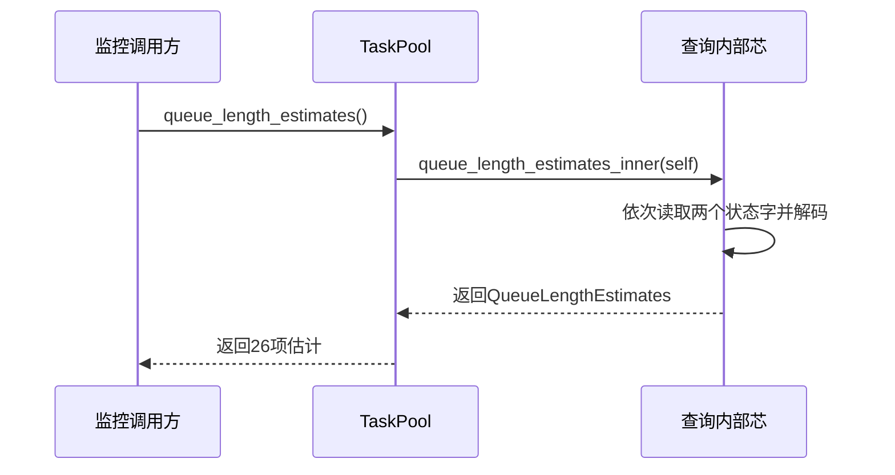

# 分队列粗略长度 · 预期调用链

## 调用链源表

| 行为 | 预期节点序列 | 成功、失败及降级 |
|---|---|---|
| 分队列只读观察 | 监控方 → TaskPool::queue_length_estimates → queue_length_estimates_inner → 读取、解码 → TaskPool::queue_length_estimates → 监控方 | 返回21+5项；无可恢复错误；并发与饱和导致近似，不额外修复 |

## 契约与归属指针

- 公开查询与结果类型的契约、单位、范围、所有权及失败状态见 [查询壳](../../../src/queue_length_estimates.rs)。
- 内部查询声明与完整伪码见 [查询芯](../../../src/queue_length_estimates_inner.rs)。当前只有TODO-DECL桩，调用会panic；这不是已完成的统计实现。
- src/lib.rs模块注册及公开重导出经lock-free-task-pool定点L7返工批准；新增文件归queue-length-estimates。其余旧API和实现不修改。
- 全册四册未启用，契约只住源码。只做本次查询，不做全系统架构核对。

## 决定与理由

- 单个结果类型含两个定长数组：分组归属清晰，固定26项无需堆分配。否：一个扁平数组——混合两种索引，容易误读。
- 方法名明确估计而非精确长度；使用共享借用，因为观察无静态接收者需求。消费者是当前监控调用方。
- 两个状态字各作一次Relaxed原子读取：只解码各自提示，不访问任务内容，无需Acquire发布同步；不保证最新值或跨状态字一致，不循环追求统一快照。否：逐队列len——用户选择低开销提示估计。此调整经用户明确批准，仅影响监控查询，不改变调度路径内存序。
- 不新增总量方法或通用可扩展框架：当前只需26项分队列监控。

## 实现切片

| 顺序 | 可独立验证行为 | 覆盖的壳芯 | 前置 | 验收 |
|---|---|---|---|---|
| 1 | 一次只读查询返回全部队列估计 | QueueLengthEstimates、公开查询、内部查询芯及入口接入 | 无 | 空池、串行四档及首末组、占用位忽略、并发五档及饱和边界、重复查询不消耗任务和不调用执行器；并发只验证范围与无副作用，不要求统一快照 |

两个数组共同组成一次查询，读取与解码由同一内部芯完成，不按函数拆票。所有壳芯均由切片1覆盖。

壳已冻结：实现者不得直接改壳、签名、src类型声明或设计产物，只实现查询芯；若需调整须回设计返工。

<!-- 已完成: 1 -->
